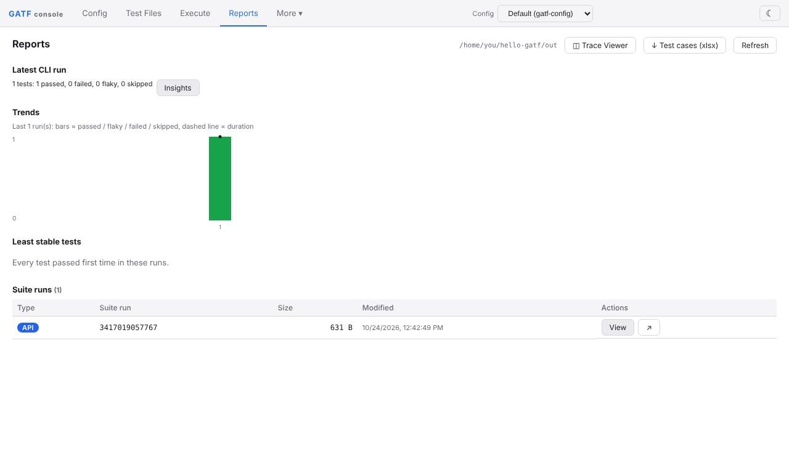

# Your first API test

You will create a project folder with a config file and one test case, start the GATF web console, and test the console's own health endpoint. Nothing else needs to be running.

## 1. Create the project

```bash
mkdir hello-gatf && cd hello-gatf
mkdir tests
```

Create `gatf-config.json`. It tells GATF where the application is (`baseUrl`), where the tests are (`testCaseDir`) and where to write reports (`outFilesDir`):

```json title="gatf-config.json"
{
  "baseUrl": "http://127.0.0.1:9080",
  "testCaseDir": "tests",
  "outFilesDir": "out"
}
```

Create `tests/health.xml` with one test case. It calls `GET /api/health`, expects status 200 with a JSON body, and checks that the `ok` and `service` fields are present:

```xml title="tests/health.xml"
<TestCases>
  <TestCase>
    <name>Health check</name>
    <url>api/health</url>
    <method>GET</method>
    <expectedResCode>200</expectedResCode>
    <expectedResContentType>application/json</expectedResContentType>
    <expectedNodes>
      <string>ok</string>
      <string>service</string>
    </expectedNodes>
  </TestCase>
</TestCases>
```

## 2. Start the web console

In a second terminal, in the same folder:

```bash
gatf ui
```

It listens on `http://127.0.0.1:9080` and logs `Started listener bound to [127.0.0.1:9080]`. The console is both the target of this test and the place to look at the results. It adds a few files to the folder (`app/`, `gatf-generator.xml`, `gatf-logging-api-int.xml`, `gatf-issuetracking-api-int.xml`, `gatf.ctrl`, `logs/`), and when you open the console in a browser it rewrites `gatf-config.json` with every default filled in. Both are expected.

## 3. Run the test

Back in the first terminal:

```bash
gatf test
```

`gatf test` uses `gatf-config.json` in the current folder (or `gatf-config.xml` when there is no JSON one). The end of the output looks like this:

```text
Running GATF API tests

  ✓  1 health.xml › Health check (90ms)

  1 passed (788ms)

  Report: /home/you/hello-gatf/out
  JUnit:  /home/you/hello-gatf/out/gatf-junit.xml
  JSON:   /home/you/hello-gatf/out/gatf-results.json
  Log:    /home/you/hello-gatf/logs/gatf.log
```

GATF 5.0.0 also prints some start-up noise in between: a JVM `WARNING: Runtime environment or build system does not support multi-release JARs…` line, `[INFO ]` log lines, sometimes a log4j `WARN StatusConsoleListener …` line, and a `TotalSuiteRuns=…` summary (twice). All of it is harmless. The exit code is `0`. On a terminal without a UTF-8 locale `✓`, `✘` and `›` print as `ok`, `x` and `>`.

## 4. See a failure

Change `<string>service</string>` to `<string>version</string>` (the health response has no `version` field) and run `gatf test` again:

```text
  ✘  1 health.xml › Health check (92ms)
       Expected Node value for version is null

  1 failed
    health.xml › Health check
```

The exit code is `1`, so a CI job fails. Change it back.

## 5. Look at the report

Open `http://127.0.0.1:9080/` in a browser: it redirects to the console at `/app/`, which opens on **Reports** with the run you just made.



 Each run is a folder under `out/`; `out/gatf-results.json` and `out/gatf-junit.xml` are the machine-readable results for CI.

## What you learned

- A project is a folder with `gatf-config.json` (or `.xml`) and test files under `testCaseDir`.
- An API test case is a request plus assertions: `expectedResCode`, `expectedResContentType` and `expectedNodes` (JSON paths for JSON responses, XPath for XML).
- `gatf test` runs everything under `testCaseDir` and exits non-zero when a test fails.

Next: [your first UI test](first-ui-test.md). To go further with API tests, see [Test cases](../concepts/test-cases.md), [Workflows](../concepts/workflows.md) and the [test case model](../../reference/test-case-model.md).
