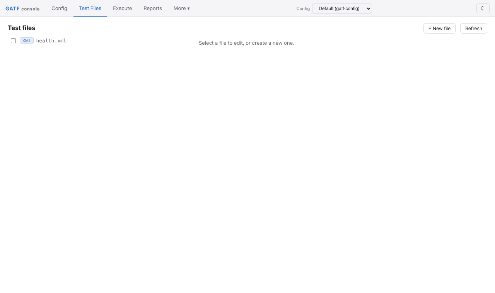
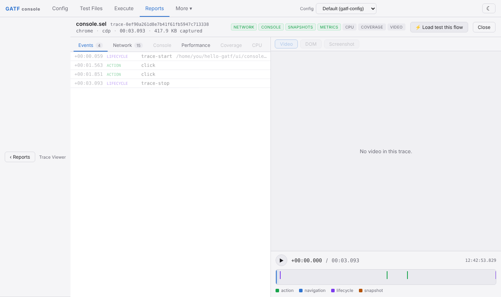

# Your first UI test

UI tests are written in seleasy, GATF's automation language. A `.sel` script is compiled into a Selenium test and run in a real browser. You will test the GATF web console itself, in the `hello-gatf` folder from the [API test](first-api-test.md), with `gatf ui` still running.

## 1. Write the script

Create `ui/console.sel`:

```sel title="ui/console.sel"
// First UI test: open the GATF web console and visit two views @smoke
open chrome
goto http://127.0.0.1:9080/app/

// the console shows its main navigation
?? role@button[name=Reports] visible = true

// open the Config view, then the Test Files view
click role@button[name=Config]
click role@button[name='Test Files']
??10 text@=health.xml visible = true
```

The script visits the console's **Test Files** view and checks that it lists `health.xml`:



- `open chrome` starts a browser session; `goto` navigates.
- `role@button[name=Reports]` is a semantic locator: a button whose accessible name is "Reports". `text@=health.xml` is an element whose text is exactly `health.xml`. CSS (`css@`), XPath (`xpath@`), `id@` and others work too.
- `??` waits for the element and then checks it; `??10` waits at most 10 seconds instead of the default 60.
- `click` waits until the element is visible, enabled and not covered before clicking (auto-wait, switched on in the config below).
- The `@smoke` tag in the first comment line lets you select the script with `gatf test --tag smoke`.

## 2. Add a UI config

UI suites use their own config. Create `gatf-config-ui.json`:

```json title="gatf-config-ui.json"
{
  "testCaseDir": "ui",
  "outFilesDir": "out-ui",
  "isSeleniumExecutor": true,
  "seleniumScripts": ["console.sel"],
  "autoWait": true,
  "webFirstAssertions": true,
  "enableTrace": true,
  "seleniumDriverConfigs": [
    { "name": "chrome", "arguments": "--headless=new" }
  ]
}
```

- `isSeleniumExecutor` makes this a UI suite; `seleniumScripts` lists the scripts to run, relative to `testCaseDir`. A UI config without `seleniumScripts` stops with `Please provide Selenium scripts for execution`.
- `autoWait` and `webFirstAssertions` make actions wait until elements are ready and retry assertions for up to 5 seconds. New projects should switch both on.
- `enableTrace` records a trace (screenshots, DOM, network, console) you can replay.
- `arguments` holds the Chrome switch for headless mode. Remove the `seleniumDriverConfigs` block to watch the browser. In 5.0.0 a local `open chrome` passes this string to Chrome as a **single** switch, so put only one switch here.

## 3. Run it

```bash
gatf test gatf-config-ui.json
```

The first run takes longer if Selenium Manager has to download Chrome or chromedriver. Then:

```text
Running GATF UI (seleasy) tests

  ✓  1 [chrome-0] › console.sel (4.6s)

  1 passed (6.6s)

  Report: /home/you/hello-gatf/out-ui
```

The trace is the `*-trace.zip` file in the run folder, for example `out-ui/867382073447/LRun-1-1-1-1-chrome-0-trace.zip`.

## 4. Replay the trace

In the console, click **◫ Trace Viewer** on the Reports view and drop the `*-trace.zip` on the page (or click it to choose the file). You get the timeline of the run's actions, its network requests and console output, and performance metrics. Add `"traceDomSnapshots": "full"` to the config to step through the page's DOM at every action, and `"traceVideo": true` for a video.



## 5. See a failure

Change `text@=health.xml` to `text@=nothere.xml` and run again:

```text
  ✘  1 [chrome-0] › console.sel (14.6s)
       Element not found by selector text@'=nothere.xml' at line number 11
       trace:      /home/you/hello-gatf/out-ui/885851856491/LRun-1-1-1-1-chrome-0-trace.zip
```

The run exits with code `1` and keeps the trace of the failed run.

## If the browser does not start

When Chrome cannot start, GATF 5.0.0 prints `No tests were executed.` and exits with code `0`. The reason is in `logs/gatf.log` (search for `Could not start a new session`). The usual causes are in [Troubleshooting](../troubleshooting.md#the-ui-run-prints-no-tests-were-executed).

Next: [your first load test](first-load-test.md). To learn the language, see [seleasy](../concepts/seleasy.md) and the [language reference](../../seleasy/REFERENCE.md).
